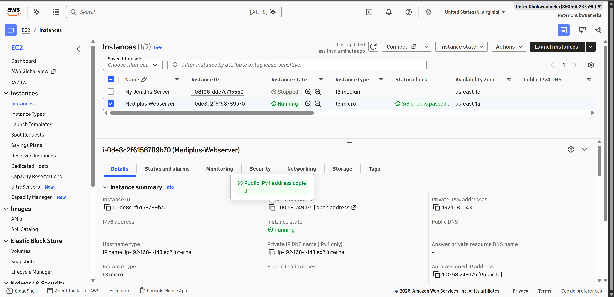
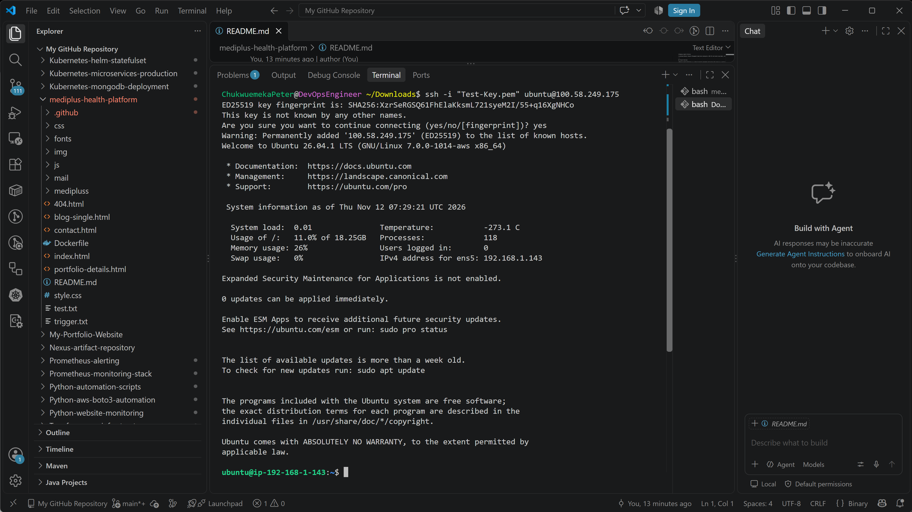
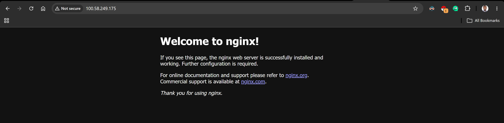
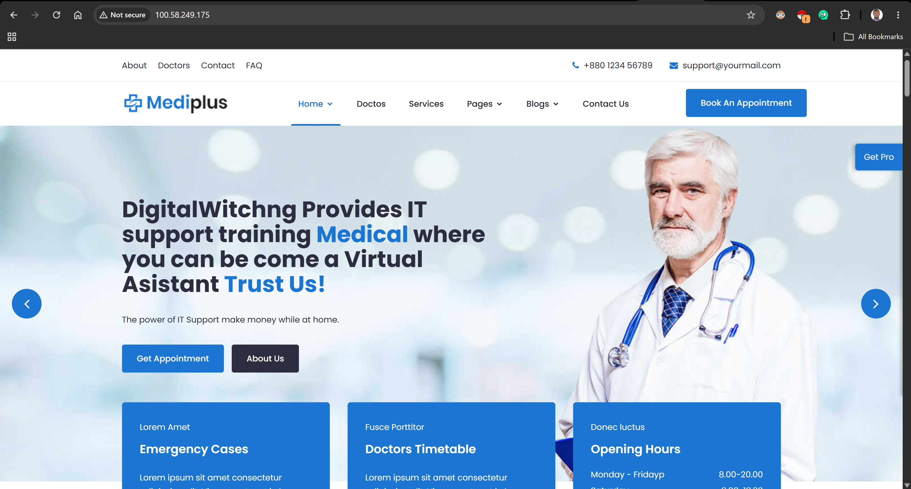

# Mediplus Health Platform – AWS EC2 Deployment

A multi-page medical hospital management website deployed on **Amazon EC2 using Ubuntu and Nginx**. This project demonstrates practical cloud deployment, Linux server administration, web server configuration, and the process of connecting a custom domain to a cloud-hosted application.

**Project Status:** <u>In Progress</u>

---

## 1. Project Overview

Mediplus Health Platform is a medical and healthcare website built primarily with HTML, CSS, and JavaScript. The application contains multiple pages designed to provide visitors with information about healthcare services, medical professionals, appointments, and other hospital-related services.

The objective of this project is to deploy the application to an AWS EC2 instance, configure Nginx as the web server, make the application publicly accessible, and eventually connect a custom domain with HTTPS encryption.

The deployment is being completed in stages, with screenshots documenting each milestone.

## 2. Project Objectives

The major objectives of this project are to:

- Deploy a multi-page web application on AWS EC2.
- Provision and configure an Ubuntu Linux server.
- Establish a secure SSH connection to the EC2 instance.
- Install and configure Nginx as the web server.
- Host the application on the EC2 instance.
- Make the application accessible through the EC2 public IP address.
- Configure a custom domain through Namecheap.
- Configure DNS records to point the domain to the EC2 public IP address.
- Verify DNS propagation using DNSChecker.
- Secure the application with HTTPS using an SSL/TLS certificate.

## 3. Technology Stack and Tools

| Technology / Tool | Purpose |
|---|---|
| AWS EC2 | Cloud infrastructure and virtual server hosting |
| Ubuntu Linux | Server operating system |
| Nginx | Web server |
| HTML5 | Application structure |
| CSS3 | Application styling |
| JavaScript | Frontend interactivity |
| PHP | Contact-form backend handler |
| Namecheap | Custom domain registration and DNS management |
| DNSChecker | DNS propagation verification |
| Let's Encrypt | Free SSL/TLS certificates |
| Certbot | SSL certificate installation and renewal |
| Git & GitHub | Version control and project documentation |

## 4. Application Architecture

The application is a multi-page website built primarily with HTML, CSS, and JavaScript. It also includes a PHP contact-form handler.

The current deployment architecture is:

```text
                  End Users
                      |
                      |
                Internet
                      |
                      |
             AWS EC2 Public IP
                      |
                      |
               Ubuntu Server
                      |
                      |
                  Nginx
                      |
                      |
             /var/www/html
                      |
                      |
           Mediplus Health Website
```

**Planned domain and HTTPS architecture:**

```text
                  End Users
                      |
                      |
                Custom Domain
                      |
                      |
                DNS Records
                 Namecheap
                      |
                      |
              DNS Resolution
                      |
                      |
             AWS EC2 Public IP
                      |
                      |
                 HTTPS
               Port 443
                      |
                      |
                   Nginx
                      |
                      |
             Mediplus Application
```

## 5. Project Repository Structure

The repository contains the application source code and deployment documentation.

```text
mediplus-health-platform/
│
├── index.html
├── contact.html
├── blog-single.html
├── portfolio-details.html
├── 404.html
│
├── css/
│   ├── style.css
│   ├── responsive.css
│   ├── bootstrap.min.css
│   ├── animate.min.css
│   └── normalize.css
│
├── js/
│   ├── main.js
│   ├── jquery.min.js
│   ├── bootstrap.min.js
│   ├── owl-carousel.js
│   ├── jquery.magnific-popup.min.js
│   └── bootstrap-datepicker.js
│
├── mail/
│   └── mail.php
│
├── docs/
│   └── images/
│       ├── aws-ec2-instance-running.png
│       ├── ec2-ssh-connection.png
│       ├── nginx-welcome-page.png
│       ├── mediplus-ec2-public-ip.png
│       ├── namecheap-dns-configuration.png
│       ├── dnschecker-propagation-results.png
│       ├── mediplus-custom-domain-live.png
│       └── mediplus-https-ssl-certificate.png
│
├── Dockerfile
└── README.md
```

*Note: The screenshot filenames above represent the planned documentation structure. The first four screenshots have been added. The remaining four should be added as the corresponding deployment stages are completed.*

## 6. Deployment Implementation and Progress

### Phase 1: AWS EC2 Instance Provisioning

An AWS EC2 virtual server was provisioned to host the Mediplus application.

The instance was configured with Ubuntu Linux and the necessary networking settings to allow remote administration and web traffic.

**Implementation evidence:**



### Phase 2: Secure SSH Connection

After provisioning the EC2 instance, an SSH connection was established from the local machine to the Ubuntu server.

This provided remote command-line access for server administration, software installation, and application deployment.

**Implementation evidence:**



### Phase 3: Nginx Installation and Verification

Nginx was installed on the Ubuntu server and tested to confirm that the web server was running successfully.

The default Nginx welcome page was used to verify that the server could receive and respond to HTTP requests.

**Implementation evidence:**



### Phase 4: Application Deployment on AWS EC2

The Mediplus application files were deployed to the EC2 instance and configured for hosting through Nginx.

The application was made publicly accessible using the EC2 instance's public IPv4 address.

**Implementation evidence:**



### Phase 5: Custom Domain Registration and DNS Configuration

**Status: Pending**

The next stage is to register or configure a custom domain through Namecheap.

Once the domain is available, the DNS records will be configured to point the domain to the public IPv4 address of the AWS EC2 instance.

The planned DNS configuration will include:

- An A record for the root domain (`@`) pointing to the EC2 public IP address.
- A CNAME record for `www` pointing to the root domain, where appropriate.

**Planned implementation evidence:**


*Screenshot pending: To be added after domain registration and DNS configuration.*

### Phase 6: DNS Propagation Verification

**Status: Pending**

After configuring the DNS records, DNS propagation will be checked using DNSChecker.

This verification will help confirm that the custom domain resolves to the correct EC2 public IP address across different DNS locations.

**Planned implementation evidence:**


*Screenshot pending: To be added after DNS propagation verification.*

### Phase 7: Application Accessibility Through Custom Domain

**Status: Pending**

Once DNS propagation is successful, the Mediplus application will be accessed through the registered custom domain rather than directly through the EC2 public IP address.

The domain will be tested in a web browser to confirm that it loads the deployed application correctly.

**Planned implementation evidence:**


*Screenshot pending: To be added after successful custom domain configuration.*

### Phase 8: HTTPS and SSL/TLS Configuration

**Status: Pending**

The final planned deployment stage is to secure the application using HTTPS.

Let's Encrypt and Certbot will be used to obtain and configure an SSL/TLS certificate on the Ubuntu server.

Nginx will then be configured to serve the application securely over HTTPS.

The final verification will confirm that:

- The custom domain loads successfully over HTTPS.
- The browser recognizes the SSL/TLS certificate as valid.
- HTTP traffic redirects to HTTPS, where configured.

**Planned implementation evidence:**


*Screenshot pending: To be added after successful SSL/TLS configuration.*

## 7. Important Application Configuration Note

The Mediplus application is primarily a static HTML, CSS, and JavaScript website. However, the source code also contains a PHP contact-form handler located at:

```text
mail/mail.php
```

The current Nginx static deployment can serve the website's frontend files, but Nginx does not execute PHP by itself.

For the PHP contact form to function correctly, PHP-FPM and the appropriate Nginx PHP configuration must be installed and configured. The PHP mail functionality may also require a properly configured mail delivery service.

Until that backend configuration is completed and tested, the contact form should not be considered fully functional.

## 8. Security Considerations

The following security practices are relevant to this deployment:

- Restrict SSH access to trusted IP addresses where practical.
- Configure AWS Security Groups to allow only required inbound traffic.
- Allow HTTP traffic on port 80 and HTTPS traffic on port 443 when needed.
- Avoid exposing private SSH keys, passwords, and credentials.
- Keep Ubuntu packages and Nginx updated.
- Configure HTTPS using a valid SSL/TLS certificate.
- Avoid storing sensitive information or patient records in a public repository.
- Review application files and configuration before making the repository public.

## 9. Skills Demonstrated

This project provides practical experience with:

- AWS EC2 provisioning and cloud infrastructure.
- Linux server administration.
- SSH remote server management.
- Nginx installation and configuration.
- Web application deployment.
- Public IP-based application hosting.
- DNS records and domain configuration.
- DNS propagation troubleshooting.
- SSL/TLS certificate configuration.
- Git and GitHub version control.
- Technical documentation and deployment evidence.

## 10. Project Completion Checklist

The following checklist tracks the implementation progress.

- [x] Provision AWS EC2 instance.
- [x] Establish successful SSH connection.
- [x] Install and verify Nginx.
- [x] Deploy Mediplus application to EC2.
- [x] Access application through EC2 public IP address.
- [ ] Register/configure custom domain through Namecheap.
- [ ] Configure DNS records.
- [ ] Verify DNS propagation using DNSChecker.
- [ ] Access application through custom domain.
- [ ] Configure HTTPS using Let's Encrypt and Certbot.
- [ ] Verify SSL/TLS certificate and secure access.
- [ ] Configure and test the PHP contact form, if required.

## 11. Expected Final Outcome

At the completion of this project, the Mediplus Health Platform will be hosted on an AWS EC2 Ubuntu server using Nginx and accessible through a custom domain.

The application will also be secured with HTTPS, with DNS records correctly resolving to the EC2 instance.

The completed project will demonstrate an end-to-end cloud-hosting workflow, from provisioning infrastructure to configuring a web server, connecting a domain, and securing web traffic.

## 12. Author

**Chukwuemeka Peter Eze**

Cloud | DevOps | Infrastructure | Security Enthusiast

- **GitHub:** [Chukwuemeka-Peter-Eze](https://github.com/Chukwuemeka-Peter-Eze)
- **Project Repository:** [Mediplus Health Platform](https://github.com/Chukwuemeka-Peter-Eze/mediplus-health-platform)

---

*This project is being documented progressively. Screenshots and implementation details will be updated as each deployment milestone is completed.*
